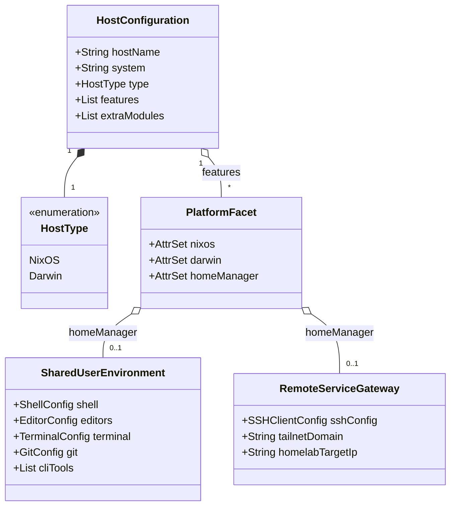

# Data Model: Integrate MacBook Air M4 Host and Mutualize Shared Configurations

**Feature**: `021-integrate-macbook-air`
**Status**: Completed
**Date**: 2026-10-21

---

## 1. Entity Overview

The system model establishes how host configurations, shared user environments, and service gateways relate within the flake's dendritic structure.

---

## 2. Key Entities & Attributes

### 2.1 Host Configuration (`HostConfiguration`)

Represents a managed physical or virtual machine declared in the repository.

| Attribute | Type | Description | Constraints |
| --- | --- | --- | --- |
| `hostName` | String | Unique machine identifier | Must match configuration name (e.g. `"macbook-air-m4-15"`). |
| `system` | String | Target Nix system tuple | `"aarch64-darwin"` for `macbook-air-m4-15`, `"x86_64-linux"` for `desktop-pc` / `homelab`. |
| `type` | HostType | Operating system ecosystem | `Darwin` (nix-darwin) or `NixOS`. |
| `features` | List of PlatformFacet | Dendritic feature modules enabled on this host | Must reference modules under `config.flake.modules.*`. |
| `extraModules` | List of Modules | Host-specific overrides | Restricted to host-specific networking/hostname; zero inline services. |

### 2.2 Shared User Environment (`SharedUserEnvironment`)

The portable collection of user-space configurations evaluated via Home Manager across all interactive workstations.

| Component | Modules | Reused Settings & Dotfiles | Platform Invariants |
| --- | --- | --- | --- |
| **Shell** | `desktop.shell` | Fish shell, Nord palette, custom aliases (`eza`, `bat`, `yazi`, `btop`), Starship prompt (`starship.toml`). | 100% identical on NixOS and Darwin. |
| **Git** | `core.git` | Git settings (diff histogram, zdiff3, pull rebase), Lazygit with Nord colorscheme. | 100% identical on NixOS and Darwin. |
| **Neovim** | `core.neovim` | LazyVim configuration (`dotfiles/nvim`), Lua options, keymaps, Tree-sitter, language parsers. | Symlinked to `~/.config/nvim` across all hosts. |
| **Editors** | `desktop.editors` | VS Code extensions (Nix IDE, Alejandra, Nord, TOML, Markdownlint), settings, ligatures, FiraCode font. | Clipboard integration adapted: native on Darwin, `wl-clipboard` on Linux. |
| **Terminal** | `desktop.terminal` | WezTerm configuration, FiraCode font, Nord color scheme. | Wayland toggle active only on Linux. |
| **CLI Apps** | `desktop.apps` | Ghostty, Obsidian, `bat`, `btop`, `eza`, `fd`, `fzf`, `jq`, `ripgrep`, `yazi`, `just`, `direnv`, `alejandra`, `statix`, `deadnix`. | Linux partitioning tools excluded on Darwin. |

### 2.3 Remote Service Gateway (`RemoteServiceGateway`)

The client connectivity layer allowing mobile workstations to access infrastructure hosted on `homelab`.

| Attribute | Value / Source | Description |
| --- | --- | --- |
| `sshHostAlias` | `"homelab"` | Convenient SSH shortcut for command line invocation (`ssh homelab`). |
| `sshHostName` | `"192.168.1.180"` | Local network IP address of the homelab server. |
| `sshUser` | `vars.userName` (`"laurent"`) | Login user on target server. |
| `sshIdentityFile` | `"~/.ssh/id_ed25519"` | Authentication key path. |
| `tailscaleMesh` | `vars.tailscaleDomain` | Remote access layer when away from the local subnet. |

---

## 3. Invariants & Validation Rules

1. **Host-Level Isolation Invariant**: A Darwin host MUST NOT import Linux-specific service daemons (Caddy, Podman, Jellyfin, AdGuard Home, etc.) or graphical compositors (Niri, Noctalia, Greetd).
2. **Path Portability Invariant**: No shared module or Home Manager declaration may hardcode `/home/` paths; all paths must use `$HOME` or Home Manager relative options (`home.homeDirectory`, `xdg.configFile`).
3. **Dendritic Modularity Invariant**: Features must encapsulate their system and user aspects cleanly in `nixos`, `darwin`, and `homeManager` keys, preserving single-file ownership per capability.
4. **Zero-Warning Evaluation Invariant**: `nix flake check` and host derivations MUST evaluate cleanly across all supported architectures (`x86_64-linux`, `aarch64-linux`, `x86_64-darwin`, `aarch64-darwin`) with zero errors.
