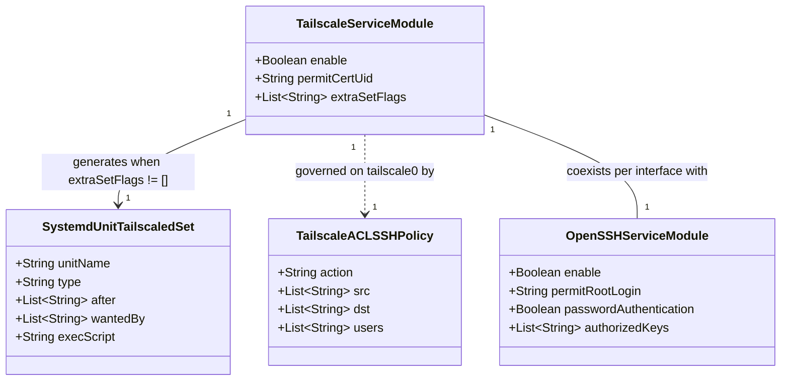

# Data Model: Dynamic Tailnet SSH Access Without Static Key Distribution

**Feature**: `022-enable-tailscale-ssh`
**Status**: Completed
**Date**: 2026-10-25

---

## 1. Entity Overview

---

## 2. Key Entities & Attributes

### 2.1 Tailscale Service Module (`modules/services/tailscale.nix`)

Defines the declarative NixOS configuration for the Tailscale mesh daemon across NixOS hosts (`homelab`, `desktop-pc`).

| Attribute | Type | Value | Description |
| --- | --- | --- | --- |
| `services.tailscale.enable` | `bool` | `true` | Enables the `tailscaled` systemd service and installs the `tailscale` CLI package. |
| `services.tailscale.permitCertUid` | `nullOr nonEmptyStr` | `"caddy"` | Grants the `caddy` user permission to fetch TLS certificates via Tailscale LocalAPI. |
| `services.tailscale.extraSetFlags` | `listOf str` | `["--ssh"]` | Flags passed to `tailscale set` via `tailscaled-set.service` to enable Tailscale SSH. |

### 2.2 Generated Systemd Unit (`systemd.services.tailscaled-set`)

Automatically synthesized by the upstream NixOS `services.tailscale` module when `extraSetFlags` is non-empty.

| Attribute | Type | Value | Description |
| --- | --- | --- | --- |
| `after` | `listOf str` | `["tailscaled.service" "tailscaled-autoconnect.service"]` | Ensures `tailscaled` is running before applying runtime flags. |
| `wants` | `listOf str` | `["tailscaled.service"]` | Pulls in the main Tailscale daemon. |
| `wantedBy` | `listOf str` | `["tailscaled.service" "multi-user.target"]` | Runs both on live `nixos-rebuild switch` (`multi-user.target`) and when `tailscaled.service` starts. |
| `partOf` | `listOf str` | `["tailscaled.service"]` | Re-runs when `tailscaled.service` is restarted. |
| `serviceConfig.Type` | `str` | `"oneshot"` | Executes once per service activation and exits cleanly. |
| `serviceConfig.RemainAfterExit` | `bool` | `true` | Marks the unit `active (exited)` so `switch-to-configuration` tracks its state properly. |
| `script` | `str` | `<tailscale-pkg>/bin/tailscale set --ssh` | Applies the `--ssh` preference to the local node state. |

### 2.3 Tailscale ACL SSH Policy (External Control Plane)

Configured in the Tailscale Admin Console policy file to authorize incoming Tailscale SSH sessions on `tailscale0`.

| Field | Type | Recommended Value | Description |
| --- | --- | --- | --- |
| `action` | `str` | `"check"` | Enforces interactive identity verification (re-auth / check mode) periodically before granting shell access. |
| `src` | `listOf str` | `["autogroup:member"]` | Authorizes authenticated members of the tailnet. |
| `dst` | `listOf str` | `["homelab"]` (or `["autogroup:self"]`) | Target tailnet nodes accepting Tailscale SSH connections. |
| `users` | `listOf str` | `["laurent", "root"]` | Local OS accounts permitted for Tailscale SSH login. |

### 2.4 Physical LAN OpenSSH Fallback (`modules/services/ssh.nix`, `modules/core/base.nix`, `modules/hosts/homelab.nix`)

Retained unchanged to service SSH connections arriving on physical network interfaces (`192.168.1.180`).

| Attribute | Scope | Value | Role |
| --- | --- | --- | --- |
| `services.openssh.enable` | NixOS (`services.ssh`) | `true` | Runs `sshd` on port 22 for LAN connections. |
| `users.users.laurent.openssh.authorizedKeys.keys` | NixOS (`core.base`) | `[personal] ++ work` | Static public keys for `laurent` over LAN. |
| `users.users.root.openssh.authorizedKeys.keys` | NixOS (`homelab`) | `[personal] ++ work` | Static public keys for `root` over LAN. |

---

## 3. State Transitions & Invariants

1. **Interface Separation Invariant**: Connections to `<user>@100.127.199.88` or `<user>@homelab.<tailnet>.ts.net` (over `tailscale0`) are authenticated by Tailscale SSH without checking `~/.ssh/authorized_keys`; connections to `<user>@192.168.1.180` (over physical Ethernet) are authenticated by OpenSSH using static public keys.
2. **Idempotent Activation Invariant**: Running `tailscale set --ssh` via `tailscaled-set.service` is idempotent across reboots and `nixos-rebuild switch` / `just switch` invocations.
3. **Zero-Secrets Invariant**: Enabling Tailscale SSH requires zero secret tokens or private keys in the Nix repository.
