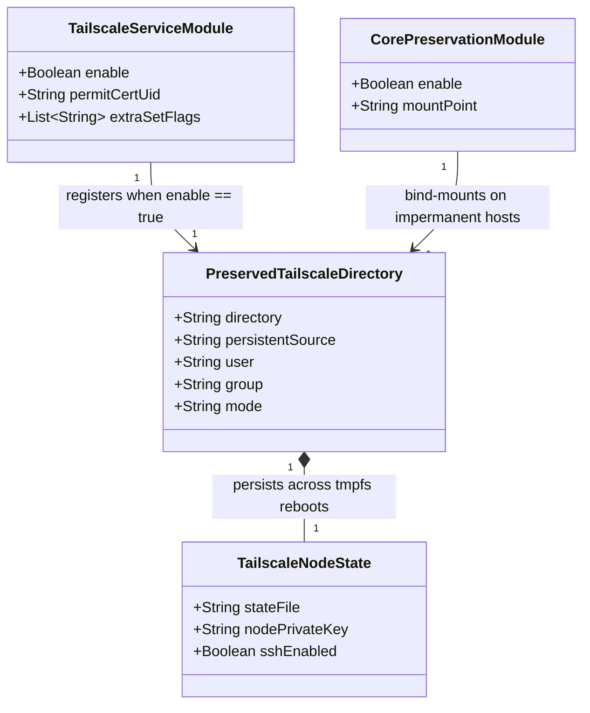

# Data Model: Persist Tailscale Node Identity and State Across Impermanent Reboots

**Feature**: `023-persist-tailscale-state`
**Status**: Completed
**Date**: 2026-10-26

---

## 1. Entity Overview

---

## 2. Key Entities & Attributes

### 2.1 Tailscale Service Module (`modules/services/tailscale.nix`)

Defines the declarative NixOS configuration for the Tailscale daemon and its persistent state directory across NixOS hosts (`homelab`, `desktop-pc`).

| Attribute | Type | Value | Description |
| --- | --- | --- | --- |
| `services.tailscale.enable` | `bool` | `true` | Enables the `tailscaled` systemd service and installs the `tailscale` CLI package. |
| `services.tailscale.permitCertUid` | `nullOr nonEmptyStr` | `"caddy"` | Grants the `caddy` user permission to fetch TLS certificates via Tailscale LocalAPI. |
| `services.tailscale.extraSetFlags` | `listOf str` | `["--ssh"]` | Flags passed to `tailscale set` via `tailscaled-set.service` to enable Tailscale SSH. |
| `preservation.preserveAt."/persistent".directories` | `listOf (either str attrs)` | `[{ directory = "/var/lib/tailscale"; user = "root"; group = "root"; mode = "0700"; }]` | Conditional preservation rule (`lib.mkIf config.services.tailscale.enable`) registering `/var/lib/tailscale` under `/persistent`. |

### 2.2 Preserved Tailscale State Directory (`PreservedTailscaleDirectory`)

The directory specification consumed by `nix-community/preservation` when `preservation.enable = true` (on `homelab`).

| Attribute | Type | Value | Validation Rule |
| --- | --- | --- | --- |
| `directory` | `str` | `"/var/lib/tailscale"` | Must match `tailscaled`'s default state directory (`--statedir=/var/lib/tailscale`). |
| `user` | `str` | `"root"` | Must be owned by `root` (the user running `tailscaled`). |
| `group` | `str` | `"root"` | Must be owned by group `root`. |
| `mode` | `str` | `"0700"` | Must restrict read/write/execute access exclusively to `root`. |

### 2.3 Runtime Files on `/persistent/var/lib/tailscale` (`TailscaleNodeState`)

Managed at runtime by `tailscaled` inside the bind-mounted directory (never committed to Git).

| Path | Owner / Mode | Role |
| --- | --- | --- |
| `/var/lib/tailscale/tailscaled.state` | `root:root` (`0600`) | Stores the node's cryptographic private key, control-plane authentication token, assigned tailnet IP (`100.127.199.88`), and local daemon preferences (`--ssh`). |

---

## 3. State Transitions & Invariants

1. **Impermanent Reboot Invariant (`homelab`)**: When `homelab` reboots and wipes `/` (`tmpfs`), `preservation` bind-mounts `/persistent/var/lib/tailscale` to `/var/lib/tailscale` before `tailscaled.service` starts, preserving `tailscaled.state` intact.
2. **Non-Impermanent Host Invariant (`desktop-pc`)**: On `desktop-pc`, `config.preservation.enable` is `false`; the entry in `config.preservation.preserveAt."/persistent".directories` is inert and generates no bind mounts or tmpfiles rules for `/persistent`.
3. **Permission Invariant**: Both `/persistent/var/lib/tailscale` and the live mount `/var/lib/tailscale` maintain `0700` (`root:root`) permissions.
