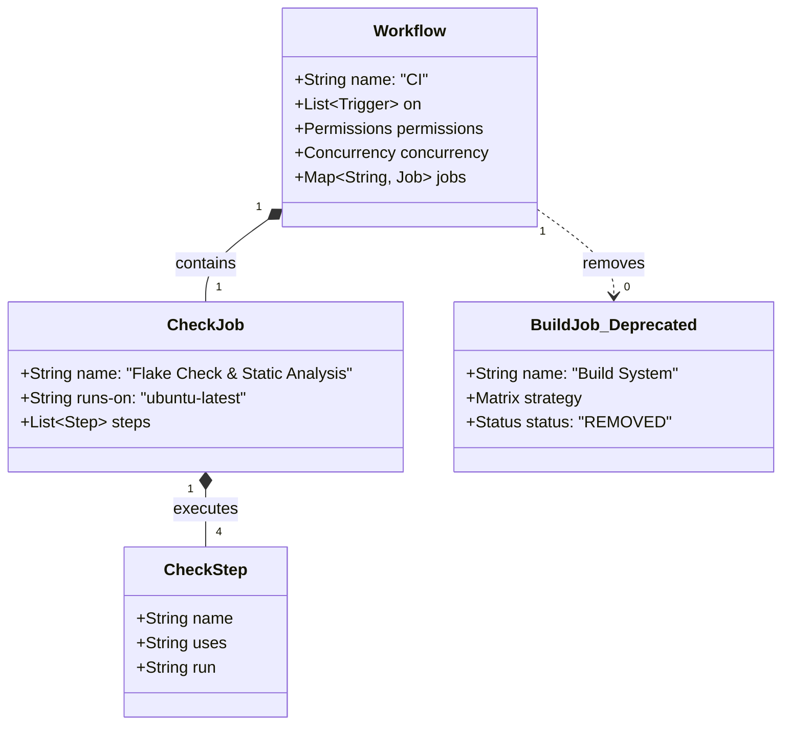
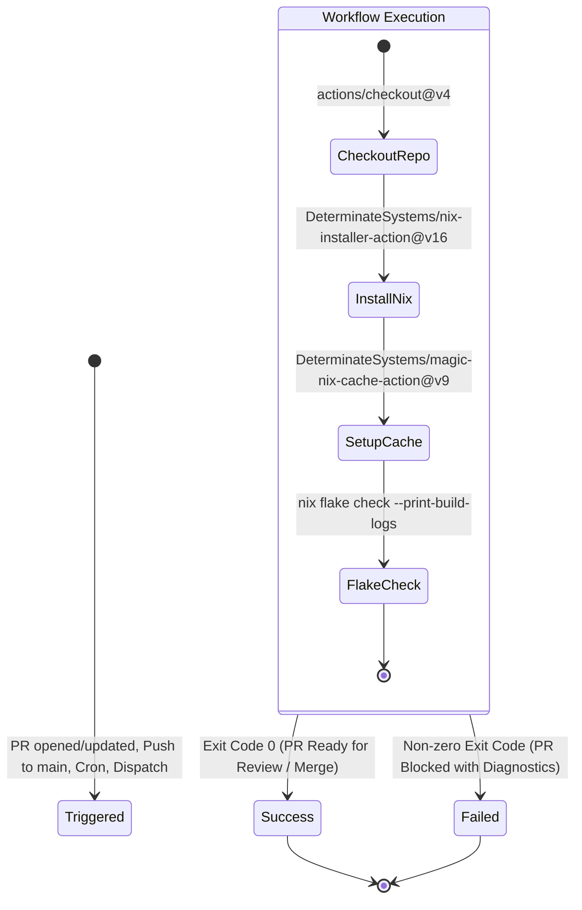

# Data Model: Fast CI Workflow (Remove Machine Builds)

**Feature**: `038-fast-ci-workflow`
**Date**: 2026-11-01
**Spec Reference**: `specs/038-fast-ci-workflow/spec.md`

## 1. Domain Entities & Structural Schema

This feature manages the CI workflow configuration entities and their execution stages within GitHub Actions.

---

## 2. Entity Definitions

### 2.1 Entity: `Workflow` (`ci.yml`)

Represents the continuous integration pipeline executed by GitHub Actions.

| Field | Type | Description | Invariant |
|---|---|---|---|
| `name` | String | Display name of the workflow | Must be `"CI"` |
| `on` | Map / List | Event triggers activating the workflow | Must include `pull_request` (target: `main`), `push` (branch: `main`), `schedule` (weekly cron), and `workflow_dispatch` |
| `permissions` | Map | Security permissions for `GITHUB_TOKEN` | Must be `contents: read` |
| `concurrency` | Map | Concurrency group and cancellation policy | Group: `${{ github.workflow }}-${{ github.ref }}`, `cancel-in-progress: true` |
| `jobs` | Map | Jobs executed in this pipeline | Contains exactly one job: `check` |

### 2.2 Entity: `CheckJob` (`check`)

The sole automated validation gate executed by the CI pipeline.

| Field | Type | Description | Invariant |
|---|---|---|---|
| `name` | String | Display name of the job | `"Flake Check & Static Analysis"` |
| `runs-on` | String | Runner environment | `"ubuntu-latest"` |
| `steps` | List | Ordered execution steps | Contains 4 steps: Checkout, Install Nix, Magic Nix Cache, Run Flake Checks |

### 2.3 Entity: `BuildJob` (*Deprecated / Removed*)

The removed multi-machine compilation matrix that formerly built complete system toplevel closures and images.

| Field | Previous State | New State |
|---|---|---|
| **Presence in `ci.yml`** | Active matrix (`desktop-pc`, `homelab`, `iso`) | **Completely Deleted** |
| **Execution Trigger** | `needs: check` | N/A |
| **Derivations Built** | `toplevel`, `isoImage` | Evaluated via `nix flake check`, compiled locally on demand |

---

## 3. Workflow Lifecycle & State Transitions

### Validation Rules

1. **Zero Matrix Jobs**: `jobs.build` MUST NOT exist in `.github/workflows/ci.yml`.
2. **Comprehensive Check**: `jobs.check` MUST run `nix flake check --print-build-logs` to validate the entire flake output hierarchy.
3. **Hermetic Dependencies**: The check job MUST rely only on GitHub Actions actions pinned to major releases (`actions/checkout@v4`, `nix-installer-action@v16`, `magic-nix-cache-action@v9`).
